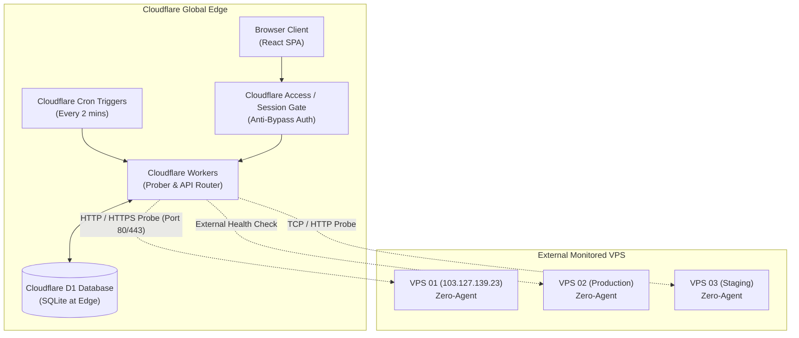

# Cloudflare VPS Monitoring Dashboard (Zero-Agent Architecture)

[](https://workers.cloudflare.com/)
[](https://developers.cloudflare.com/d1/)
[](https://react.dev/)
[](https://www.typescriptlang.org/)
[](https://tailwindcss.com/)
[](LICENSE)

Dashboard monitoring VPS terpusat, modern, ringan, aman, dan responsif yang beroperasi **100% pada infrastruktur Cloudflare (Edge)**. 

Dirancang dengan prinsip **Zero-Agent Monitoring**: VPS yang dimonitor sama sekali **tidak dipasangi agent, daemon, exporter, ataupun software tambahan apa pun**. Semua pengecekan dilakukan murni secara eksternal melalui jaringan edge global Cloudflare.

---

## Fitur Utama

### 1. Uptime Monitoring (Zero-Agent External Checks)
- Pemeriksaan berkala HTTP dan HTTPS dari edge Cloudflare.
- Klasifikasi status otomatis:
  - **Online**: Layanan merespons status 2xx/3xx dalam latensi normal.
  - **Degraded**: Latensi tinggi (> threshold e.g. 1000ms) atau respons HTTP 4xx.
  - **Offline**: Connection timeout, connection refused, atau HTTP server error 5xx.
- Perhitungan persentase Uptime akurat untuk **24 Jam**, **7 Hari**, dan **30 Hari**.
- Pelacakan insiden downtime otomatis: mencatat waktu mulai, waktu pemulihan, durasi, dan penyebab kendala.

### 2. Latency Monitoring (HTTP Response Time)
- Pengukuran akurat *round-trip HTTP response time* (bukan ICMP ping).
- Menampilkan metrik **Minimum**, **Average**, dan **Maximum Latency** dalam 24 jam.
- Grafik visual interaktif dengan **Recharts** (mendukung rentang waktu 1 Jam, 6 Jam, 24 Jam, 7 Hari, dan 30 Hari).
- Indikator peringatan visual saat terjadi lonjakan latensi (*High Latency Indicator*).

### 3. Kebijakan Integritas Metrik Internal (CPU, RAM, Disk)
- Sesuai prinsip **Zero-Agent Monitoring**, sistem **tidak membuat angka palsu atau estimasi fiktif**.
- Metrik CPU, RAM, dan Disk secara transparan ditampilkan sebagai:
  > **Not available • Requires internal metrics**
- Memberikan kepastian bahwa VPS target bersih dari overhead pemantauan dan kebal terhadap eksploitasi agent pihak ketiga.

### 4. Keamanan Anti-Bypass & Akses Terkontrol
- **Anti-Bypass Protection**: Mengamankan dashboard agar tidak dapat diakses atau di-bypass secara sembarangan meskipun diakses melalui URL worker langsung.
- **Dual-Layer Authentication**:
  1. **Cloudflare Zero Trust Access**: Verifikasi kriptografis token JWT (`Cf-Access-Jwt-Assertion`) jika diaktifkan pada subdomain.
  2. **Dashboard Session Token**: Token sesi terenkripsi HMAC-SHA256 yang disimpan dalam HTTP-Only Cookie (`SameSite=Lax`, `Secure`).
- **Brute-Force Protection**: Form login dilindungi pembatasan percobaan gagal.

### 5. Throttling & Sliding-Window Rate Limiting
- Proteksi berbasis database Cloudflare D1 terhadap penyalahgunaan API dan brute force:
  - **Login Attempt**: Maksimal 5 percobaan per 15 menit per IP. Jika terlampaui, IP dikunci sementara (HTTP 429).
  - **Manual Probe**: Maksimal 10 trigger per menit per IP untuk mencegah *probe flooding*.
  - **General API**: Maksimal 60 request per menit per IP.
- Mengirimkan header standar IETF: `Retry-After`, `X-RateLimit-Limit`, `X-RateLimit-Remaining`, `X-RateLimit-Reset`.

### 6. Server-Side Pagination
- Riwayat insiden dan downtime dikelola dengan paginasi berbasis SQL (`LIMIT` dan `OFFSET`).
- Navigasi halaman cepat, responsif, dan ringan tanpa membebani memori browser.

---

## Arsitektur Sistem



---

## Panduan Instalasi & Deploy ke Cloudflare

### Prasyarat
- Node.js v18+ dan npm
- Akun Cloudflare aktif
- Cloudflare CLI `wrangler` terinstall (`npx wrangler`)

### Langkah 1: Clone & Install Dependencies
```bash
git clone https://github.com/ryuarnovi/monitoring-dashboard.git
cd monitoring-dashboard
npm install
```

### Langkah 2: Buat Database Cloudflare D1
Jalankan perintah berikut untuk membuat database D1 di akun Cloudflare Anda:
```bash
npx wrangler d1 create vps_monitor_db
```
Salin `database_id` yang dihasilkan, lalu buka file `wrangler.jsonc` dan perbarui baris `database_id`:
```jsonc
"d1_databases": [
  {
    "binding": "DB",
    "database_name": "vps_monitor_db",
    "database_id": "MASUKKAN_DATABASE_ID_ANDA_DISINI"
  }
]
```

### Langkah 3: Eksekusi Migrasi Skema Database D1
Terapkan tabel `targets`, `health_checks`, `incidents`, `sessions`, dan `rate_limits` ke database D1:
```bash
# Untuk produksi (Cloudflare Remote D1):
npm run d1:init:prod

# Untuk pengujian lokal:
npm run d1:init
```

### Langkah 4: Konfigurasi Password Admin (Anti-Bypass Secret)
Setel password admin dashboard menggunakan Cloudflare Secrets:
```bash
npx wrangler secret put ADMIN_PASSWORD
# Masukkan password Anda (misal: Workerkubabi@1234)

npx wrangler secret put SESSION_SECRET
# Masukkan string acak untuk salt HMAC sesi
```

### Langkah 5: Build Frontend & Deploy ke Cloudflare Workers
```bash
npm run worker:deploy
```
Perintah ini akan secara otomatis:
1. Mem-build Single Page Application (React + Vite + Tailwind CSS) ke folder `./dist`.
2. Mengunggah aset statis dan Worker ke jaringan Cloudflare Edge.
3. Mengaktifkan Cloudflare Cron Trigger (`*/2 * * * *`).

### Langkah 6: Hubungkan Subdomain Pribadi
Untuk mengakses dashboard melalui subdomain Anda (misalnya `https://monitor.DOMAIN.COM`):
1. Masuk ke **Cloudflare Dashboard** &rarr; **Workers & Pages**.
2. Pilih worker **`cloudflare-vps-monitoring`**.
3. Buka tab **Settings** &rarr; **Domains & Routes** &rarr; Klik **Add** &rarr; **Custom Domain**.
4. Masukkan subdomain: `monitor.DOMAIN.COM`.
5. Cloudflare DNS akan mengonfigurasi DNS record dan menerbitkan sertifikat SSL/TLS otomatis!

### Langkah 7 (Opsional): Proteksi dengan Cloudflare Zero Trust Access
1. Masuk ke **Cloudflare Zero Trust Dashboard** &rarr; **Access** &rarr; **Applications**.
2. Klik **Add an Application** &rarr; Pilih **Self-hosted**.
3. Masukkan domain `monitor.DOMAIN.COM`.
4. Konfigurasikan kebijakan akses (Access Policy), misalnya izinkan hanya alamat email tim Anda.
5. Salin Application AUD tag dan masukkan ke secret Worker:
   ```bash
   npx wrangler secret put CF_ACCESS_AUD
   npx wrangler secret put CF_ACCESS_TEAM_DOMAIN
   ```

---

## Struktur Folder Proyek

```
monitoring/
├── migrations/
│   └── 0001_initial_schema.sql      # Skema tabel D1 (targets, checks, incidents, sessions, rate_limits)
├── src/
│   ├── types/
│   │   └── index.ts                 # Definisi tipe TypeScript bersama
│   ├── worker/
│   │   ├── index.ts                 # Worker entrypoint (Fetch & Scheduled Cron handler)
│   │   ├── api.ts                   # REST API router & middleware
│   │   ├── auth.ts                  # Anti-bypass auth (HMAC sessions & Cloudflare Access)
│   │   ├── rate-limit.ts            # Throttling & sliding-window rate limiter
│   │   ├── prober.ts                # External probe engine (Fetch & Raw Socket fallback)
│   │   ├── db.ts                    # D1 query helpers & paginasi
│   │   └── types.ts                 # Interface Worker Env bindings
│   └── client/
│       ├── main.tsx                 # Entrypoint React 18
│       ├── App.tsx                  # Dashboard container & state controller
│       ├── format.ts                # Utility format tanggal & API fetcher
│       ├── components/
│       │   ├── Navbar.tsx           # Header, live colo indicator & logout
│       │   ├── LoginScreen.tsx      # Anti-bypass modern login screen
│       │   ├── SummaryCards.tsx     # Overview metrik node & rata-rata latensi
│       │   ├── ServerCard.tsx       # Kartu VPS (Status, HTTP code, uptime, zero-agent hardware note)
│       │   ├── LatencyChart.tsx     # Grafik latensi Recharts (1h, 6h, 24h, 7d, 30d)
│       │   ├── IncidentHistory.tsx  # Tabel downtime dengan server-side pagination
│       │   ├── AddServerModal.tsx   # Modal tambah node VPS target
│       │   └── ArchitectureGuide.tsx# Panduan teknis & arsitektur Zero-Agent
├── index.html                       # HTML wrapper aplikasi
├── package.json                     # Definisi dependensi & skrip build
├── tailwind.config.js               # Konfigurasi Tailwind CSS
├── vite.config.ts                   # Konfigurasi Vite & rollup chunks
└── wrangler.jsonc                   # Konfigurasi Cloudflare Workers & D1 bindings
```

---

## Ringkasan Endpoint API

| Method | Endpoint | Keterangan | Proteksi |
| :--- | :--- | :--- | :--- |
| `POST` | `/api/auth/login` | Login admin, membuat sesi HMAC & cookie | Throttled (5x/15m) |
| `POST` | `/api/auth/logout`| Keluar sesi & hapus cookie | Bebas |
| `GET`  | `/api/auth/me`    | Cek status autentikasi aktif | Bebas |
| `GET`  | `/api/overview`   | Ringkasan status seluruh infrastruktur | Authed + Throttled (60/m) |
| `GET`  | `/api/targets`    | Daftar seluruh node VPS & uptime 24h/7d/30d | Authed + Throttled (60/m) |
| `POST` | `/api/targets`    | Menambahkan node VPS baru ke pemantauan | Authed + Throttled (60/m) |
| `DELETE`| `/api/targets/:id`| Menghapus node VPS dari pemantauan | Authed + Throttled (60/m) |
| `GET`  | `/api/targets/:id/history?hours=24` | Data time-series latensi untuk grafik | Authed + Throttled (60/m) |
| `POST` | `/api/targets/:id/probe` | Menjalankan probe eksternal instan | Authed + Throttled (10/m) |
| `POST` | `/api/probes/run-all` | Menjalankan probe ke seluruh node sekaligus | Authed + Throttled (10/m) |
| `GET`  | `/api/incidents?page=1&limit=10` | Riwayat insiden dengan server-side pagination | Authed + Throttled (60/m) |

---

## Lisensi

Didistribusikan di bawah lisensi MIT. Bebas digunakan untuk kebutuhan personal maupun komersial.
